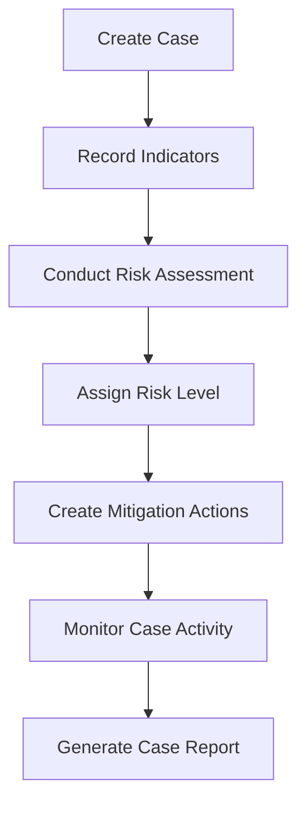

# Protective Intelligence Risk Tracker

A case-management and risk-assessment application designed to support protective intelligence workflows.

The Protective Intelligence Risk Tracker allows analysts and security professionals to document cases, record observable indicators, conduct structured risk assessments, manage mitigation actions, review case activity, and generate printable case reports from a centralized dashboard.

## Current Version

**Version 0.5.0 — Professional MVP Development**

The application is under active development. The current version is intended for demonstration, education, and software-development purposes.

> Do not store classified information, controlled unclassified information, personally identifiable information, operational security information, or other sensitive data in the current development version.

## Current Capabilities

- Create, view, search, filter, update, and delete cases
- Record protective-intelligence indicators
- Document source and credibility information
- Conduct structured risk assessments
- Automatically update the case risk level
- Create and track mitigation actions
- Mark mitigation actions as completed
- Maintain a chronological case activity timeline
- Generate printable case reports
- Save reports as PDF through the browser
- Validate API data with Pydantic
- Store development data in SQLite
- Test application behavior with pytest
- Access interactive API documentation through FastAPI

## Application Workflow



## Technology Stack

- Python 3.11
- FastAPI
- SQLAlchemy
- Pydantic
- SQLite
- Pytest
- HTML
- CSS
- JavaScript
- Uvicorn

## Project Structure

```text
protective-intelligence-risk-tracker/
├── app/
│   ├── static/
│   │   ├── app.js
│   │   ├── index.html
│   │   └── styles.css
│   ├── __init__.py
│   ├── database.py
│   ├── main.py
│   ├── models.py
│   ├── reporting.py
│   └── schemas.py
├── tests/
│   └── test_main.py
├── .gitignore
├── README.md
└── requirements.txt
```

## Installation

### 1. Clone the repository

```powershell
git clone https://github.com/CINEntertainment/protective-intelligence-risk-tracker.git
cd protective-intelligence-risk-tracker
```

### 2. Create a virtual environment

```powershell
python -m venv .venv
```

### 3. Activate the virtual environment

```powershell
.\.venv\Scripts\Activate.ps1
```

If PowerShell prevents activation, run:

```powershell
Set-ExecutionPolicy -Scope Process -ExecutionPolicy RemoteSigned
.\.venv\Scripts\Activate.ps1
```

### 4. Install dependencies

```powershell
python -m pip install --upgrade pip
pip install -r requirements.txt
```

## Running the Application

Start the development server:

```powershell
uvicorn app.main:app --reload
```

Open the dashboard:

```text
http://127.0.0.1:8000/dashboard
```

Open the interactive API documentation:

```text
http://127.0.0.1:8000/docs
```

## Running the Tests

Run the complete test suite:

```powershell
python -m pytest -v
```

The current test suite contains 37 automated tests covering:

- Health and root endpoints
- Case CRUD operations
- Duplicate-case validation
- Indicator operations
- Risk-assessment operations
- Automatic case-risk updates
- Mitigation-action operations
- Activity and audit records
- Printable case reports
- Missing-resource responses
- Input validation

## Printable Reports

Each case includes a **View Report** action.

The report contains:

- Case overview
- Recorded indicators
- Risk assessments
- Mitigation actions
- Case activity timeline

Use the report page’s **Print / Save as PDF** button to print the report or save it as a PDF through the browser.

## API Overview

| Method | Endpoint | Purpose |
|---|---|---|
| `GET` | `/health` | Check application health |
| `GET` | `/cases` | List cases |
| `POST` | `/cases` | Create a case |
| `GET` | `/cases/{case_id}` | Retrieve case details |
| `PATCH` | `/cases/{case_id}` | Update a case |
| `DELETE` | `/cases/{case_id}` | Delete a case |
| `POST` | `/cases/{case_id}/indicators` | Add an indicator |
| `GET` | `/cases/{case_id}/indicators` | List indicators |
| `DELETE` | `/cases/{case_id}/indicators/{indicator_id}` | Delete an indicator |
| `POST` | `/cases/{case_id}/assessments` | Add an assessment |
| `GET` | `/cases/{case_id}/assessments` | List assessments |
| `DELETE` | `/cases/{case_id}/assessments/{assessment_id}` | Delete an assessment |
| `POST` | `/cases/{case_id}/mitigations` | Add a mitigation |
| `GET` | `/cases/{case_id}/mitigations` | List mitigations |
| `PATCH` | `/cases/{case_id}/mitigations/{mitigation_id}` | Update a mitigation |
| `DELETE` | `/cases/{case_id}/mitigations/{mitigation_id}` | Delete a mitigation |
| `GET` | `/cases/{case_id}/activities` | View case activity |
| `GET` | `/cases/{case_id}/report` | View printable report |

## Development Roadmap

### Version 0.6.0 — Professional MVP Polish

- Case sorting
- Overdue-review warnings
- Overdue-mitigation warnings
- Case archiving
- Interface and validation improvements
- Expanded automated testing

### Version 0.7.0 — Authentication

- Secure user registration and login
- Password hashing
- Session or token management
- Named-user activity records

### Version 0.8.0 — Authorization

- Administrator role
- Analyst role
- Reviewer role
- Read-only role
- Endpoint-level permissions

### Version 0.9.0 — Production Data Architecture

- PostgreSQL support
- Alembic database migrations
- Environment-based configuration
- Backup and restoration procedures
- Production security settings

### Version 1.0.0 — Secure Beta

- Deployment configuration
- HTTPS
- Security hardening
- Complete documentation
- Demonstration dataset
- Controlled user testing

## Security Status

The current version does not yet include:

- Authentication
- Role-based authorization
- Encryption at rest
- Organizational data separation
- Formal security certification
- Independent penetration testing

Only fictional, synthetic, or otherwise non-sensitive demonstration data should be entered.

## Future Direction

Long-term development may include:

- Entity and relationship analysis
- Persons, organizations, locations, facilities, and vehicles
- Watchlists
- Structured source evaluation
- Case assignments
- Review notifications
- Geospatial visualization
- Analytical dashboards
- Intelligence requirements
- Collection-gap tracking
- Secure document attachments
- Integration with the Intel Notes Manager

## License

Copyright © 2026 CIN Entertainment. All rights reserved.

No license is currently granted for redistribution, modification, commercial use, or deployment outside authorized testing and demonstration environments.

## Developer

Developed by **CIN Entertainment** as part of an expanding portfolio of intelligence, risk-management, and analytical software.