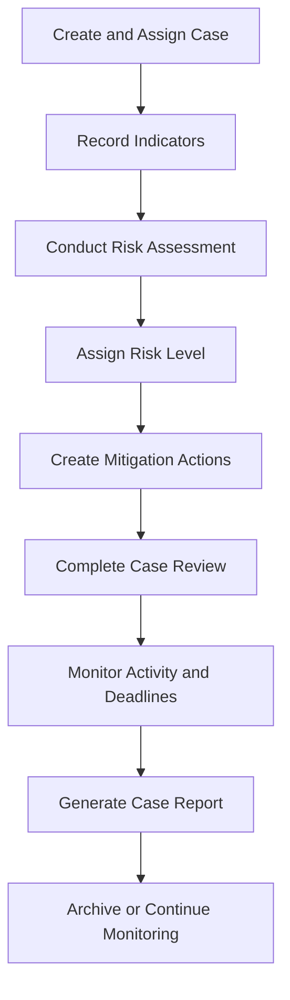

# Protective Intelligence Risk Tracker


A locally operated case-management and risk-assessment application designed to support protective intelligence workflows.

The Protective Intelligence Risk Tracker gives analysts and security professionals a centralized interface for documenting cases, recording observable indicators, conducting structured risk assessments, managing mitigation actions, completing periodic reviews, preserving case history, and generating printable reports.

## Project Status

**Complete - Version 1.0.0**

Version 1.0.0 is the first stable local-use release.

The application is intended to run on an authorized local workstation. It includes authentication, role-based permissions, structured analytical workflows, local database storage, printable reporting, and a comprehensive automated test suite.

This release is suitable for:

- Local operational use with authorized data
- Protective-intelligence workflow demonstrations
- Portfolio and software-development review
- Training with fictional or approved datasets
- Continued internal development by CIN Entertainment

> Do not enter classified information, controlled unclassified information, protected personal information, or other sensitive operational data unless the system and host environment have been formally approved for that information.

## Core Capabilities

### Case Management

- Create, view, search, filter, update, archive, restore, and delete cases
- Assign cases to analysts and responsible teams
- Track case status, priority, risk level, and review dates
- Sort cases by review urgency, update date, creation date, priority, or case number
- Identify overdue, due-today, due-soon, scheduled, and unscheduled reviews
- Filter cases by status, archive state, analyst, team, and review condition

### Protective Intelligence Analysis

- Record observable indicators
- Document indicator type, source, credibility, and observation date
- Conduct structured threat, vulnerability, impact, and overall-risk assessments
- Automatically synchronize the case risk level with the latest assessment
- Record analytical rationale and recommended actions
- Preserve assessment history

### Risk Treatment

- Create and manage mitigation actions
- Assign mitigation owners
- Track priority, status, due dates, and completion dates
- Identify overdue and upcoming mitigation deadlines
- Mark mitigation actions as completed
- Preserve mitigation history in the case activity timeline

### Case Reviews

- Record formal case reviews
- Document reviewer findings
- Schedule the next review date
- Maintain review history
- Record review activity automatically

### Reporting and Audit History

- Maintain a chronological case activity timeline
- Record major case, indicator, assessment, mitigation, review, archive, and assignment events
- Generate printable case reports
- Print reports or save them as PDF through the browser
- Access interactive API documentation through FastAPI

## Authentication and Roles

The application uses password hashing, JWT authentication, HTTP-only authentication cookies, and backend-enforced role permissions.

| Role | Access |
|---|---|
| Administrator | Full access, user management, permanent deletion, and all operational functions |
| Analyst | Create and update cases, indicators, assessments, reviews, and mitigation actions |
| Reviewer | View cases and reports, conduct assessments, and record case reviews |
| Read Only | View cases, reports, analytical records, and case history |

The dashboard automatically hides controls that are unavailable to the logged-in role. Backend authorization remains the primary security control.

## Application Workflow



## Technology Stack

- Python 3.11
- FastAPI
- SQLAlchemy
- Pydantic
- SQLite
- PyJWT
- pwdlib with Argon2
- python-dotenv
- Pytest
- HTML
- CSS
- JavaScript
- Uvicorn

## Project Structure

```text
protective-intelligence-risk-tracker/
|-- app/
|   |-- static/
|   |   |-- app.js
|   |   |-- index.html
|   |   `-- styles.css
|   |-- __init__.py
|   |-- auth.py
|   |-- database.py
|   |-- main.py
|   |-- models.py
|   |-- reporting.py
|   `-- schemas.py
|-- tests/
|   `-- test_main.py
|-- .env.example
|-- .gitignore
|-- README.md
`-- requirements.txt
```

## Installation

### 1. Clone the repository

```powershell
git clone https://github.com/CINentertainment/protective-intelligence-risk-tracker.git
cd protective-intelligence-risk-tracker
```

### 2. Create a virtual environment

```powershell
python -m venv .venv
```

### 3. Activate the virtual environment

```powershell
.\.venv\Scripts\Activate.ps1
```

If PowerShell prevents activation:

```powershell
Set-ExecutionPolicy -Scope Process -ExecutionPolicy RemoteSigned
.\.venv\Scripts\Activate.ps1
```

### 4. Install dependencies

```powershell
python -m pip install --upgrade pip
python -m pip install -r requirements.txt
```

### 5. Create the local environment configuration

Generate a random authentication secret:

```powershell
$secret = python -c "import secrets; print(secrets.token_urlsafe(48))"
"PIRT_SECRET_KEY=$secret" | Set-Content .env
```

The `.env` file is excluded from Git and must never be committed.

The included `.env.example` documents the required variable without containing a real secret.

## Running the Application

Start the local server:

```powershell
uvicorn app.main:app --reload
```

Open the dashboard:

```text
http://127.0.0.1:8000/dashboard
```

Open the interactive API documentation:

```text
http://127.0.0.1:8000/docs
```

Stop the application with `Ctrl+C`.

## Initial Administrator Setup

When the application is started with no existing users:

1. Open the dashboard.
2. Select the administrator setup option.
3. Enter the initial administrator username, full name, and password.
4. Sign in with the newly created account.
5. Create additional users and assign appropriate roles.

Only the first administrator can be created through the bootstrap process. Subsequent user management requires an authenticated Administrator account.

## Running the Tests

Run the complete automated test suite:

```powershell
python -m pytest -v
```

Version 1.0.0 contains **79 automated tests** covering:

- Root, health, dashboard, and OpenAPI endpoints
- Case creation, listing, retrieval, updating, and deletion
- Duplicate case-number validation
- Case assignment and reassignment
- Archive and restore operations
- Search and review-date behavior
- Indicator operations
- Risk-assessment operations
- Automatic case-risk updates
- Mitigation-action operations
- Case reviews and review scheduling
- Case activity and audit records
- Printable case reports
- User bootstrap and authentication
- Password hashing
- Authentication cookies
- User administration
- Role-based authorization
- Missing-resource handling
- Input validation

## Printable Reports

Each case includes a **View Report** action.

Reports include:

- Case overview
- Assignment information
- Recorded indicators
- Risk assessments
- Mitigation actions
- Review information
- Case activity timeline

Use the report page's **Print / Save as PDF** button to print the report or save it as a PDF through the browser.

## Data Storage

Application data is stored locally in:

```text
protective_intelligence.db
```

The database file is excluded from Git.

Before backing up the database:

1. Stop the Uvicorn server.
2. Copy `protective_intelligence.db` to an approved backup location.
3. Protect the backup according to the sensitivity of the stored information.

Restoring a backup requires stopping the application and replacing the local database file with the approved backup copy.

## API Overview

| Method | Endpoint | Purpose |
|---|---|---|
| `GET` | `/health` | Check application health |
| `POST` | `/auth/bootstrap` | Create the initial administrator |
| `POST` | `/auth/login` | Authenticate a user |
| `POST` | `/auth/logout` | End the current session |
| `GET` | `/auth/me` | Retrieve the authenticated user |
| `GET` | `/users` | List users as an Administrator |
| `POST` | `/users` | Create a user as an Administrator |
| `GET` | `/cases` | List cases |
| `POST` | `/cases` | Create a case |
| `GET` | `/cases/{case_id}` | Retrieve case details |
| `PATCH` | `/cases/{case_id}` | Update a case |
| `DELETE` | `/cases/{case_id}` | Permanently delete a case |
| `PATCH` | `/cases/{case_id}/archive` | Archive a case |
| `PATCH` | `/cases/{case_id}/restore` | Restore a case |
| `GET` | `/cases/{case_id}/activities` | View case activity |
| `POST` | `/cases/{case_id}/reviews` | Record a case review |
| `GET` | `/cases/{case_id}/reviews` | List case reviews |
| `POST` | `/cases/{case_id}/indicators` | Add an indicator |
| `GET` | `/cases/{case_id}/indicators` | List indicators |
| `DELETE` | `/cases/{case_id}/indicators/{indicator_id}` | Delete an indicator |
| `POST` | `/cases/{case_id}/assessments` | Add an assessment |
| `GET` | `/cases/{case_id}/assessments` | List assessments |
| `DELETE` | `/cases/{case_id}/assessments/{assessment_id}` | Delete an assessment |
| `POST` | `/cases/{case_id}/mitigations` | Add a mitigation action |
| `GET` | `/cases/{case_id}/mitigations` | List mitigation actions |
| `PATCH` | `/cases/{case_id}/mitigations/{mitigation_id}` | Update a mitigation action |
| `DELETE` | `/cases/{case_id}/mitigations/{mitigation_id}` | Delete a mitigation action |
| `GET` | `/cases/{case_id}/report` | View the printable case report |

Exact authorization requirements are documented in the interactive API documentation and enforced by the backend.

## Security Notes

Version 1.0.0 includes:

- Argon2 password hashing
- JWT-based authentication
- HTTP-only authentication cookies
- Environment-based authentication secrets
- Administrator, Analyst, Reviewer, and Read Only roles
- Backend endpoint authorization
- Role-aware dashboard controls
- Local database and secret-file exclusions
- Automated authentication and authorization testing

This local release has not undergone:

- Independent penetration testing
- Formal security certification
- Authorization to process classified information
- Encryption-at-rest implementation
- Multi-organization tenant isolation
- Internet-facing production hardening

The application should remain bound to the local interface unless it is separately hardened and approved for network deployment.

## Known Warning

The test suite may display a Starlette deprecation warning concerning the testing transport dependency. This warning originates from the dependency stack and does not currently cause test failures.

## Release Scope

Version 1.0.0 completes the planned local-use application scope:

- Case-management workflow
- Protective-intelligence analytical workflow
- Risk treatment and mitigation tracking
- Case assignments
- Scheduled case reviews
- Archive and restore
- Authentication
- User administration
- Role-based authorization
- Role-aware dashboard controls
- Printable reporting
- Automated testing
- Environment-based secret configuration

Potential future work, if the application is prepared for organizational or commercial deployment, may include:

- PostgreSQL
- Alembic database migrations
- HTTPS and reverse-proxy configuration
- Login rate limiting
- Encrypted file attachments
- Formal backup automation
- Multi-tenant organizational separation
- Deployment monitoring
- Independent security assessment
- Integration with the Intel Notes Manager

These items are outside the completed version 1.0 local-use scope.

## License

Copyright (c) 2026 CIN Entertainment. All rights reserved.

No license is granted for redistribution, modification, commercial use, sublicensing, or deployment outside environments authorized by CIN Entertainment.

## Developer

Developed by **CIN Entertainment** as part of an expanding portfolio of intelligence, risk-management, analytical, and decision-support software.